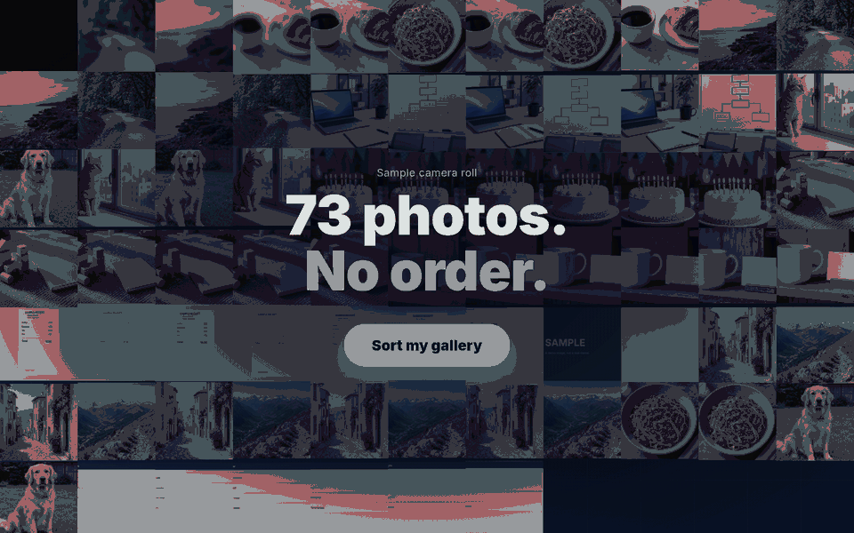
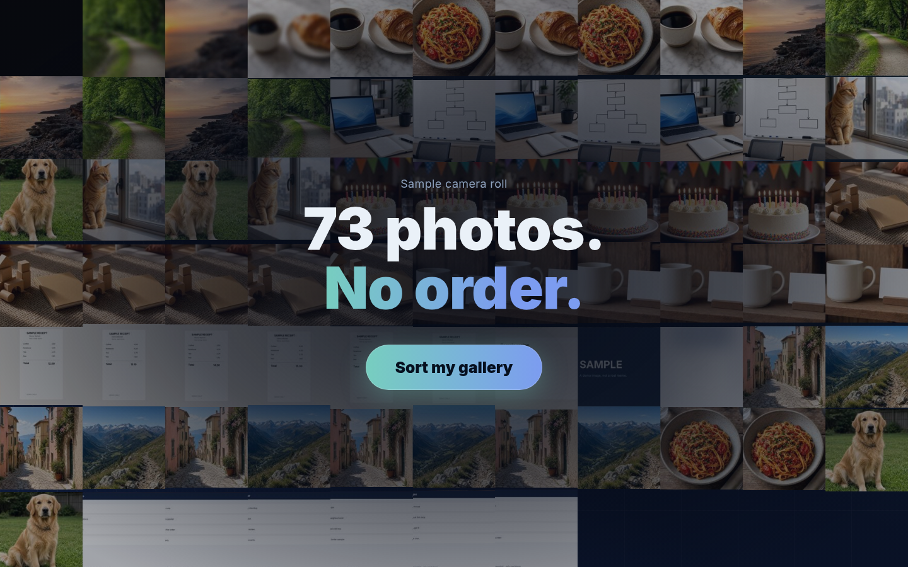
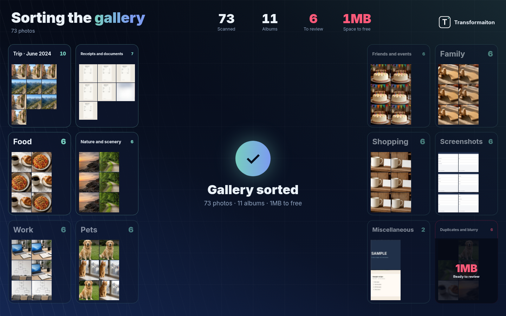

# Gallery Sorter

Gallery Sorter is a [Claude Code](https://claude.com/claude-code) skill that takes a phone camera roll, works out what each photo is, and copies it into topic folders. It also sets duplicates and blurry shots aside for you to review.

It copies. It does not delete a photo, and it does not move or change the original.

It is built for small businesses whose camera rolls mix receipts, job photos, and everyday pictures, and for anyone who can no longer find a photo by scrolling.



The clip is the real studio, run on the generated sample photos in [`examples/demo-roll`](examples/demo-roll). Nothing in that roll is a personal photo.

Before you click, the roll is one wall:



After it finishes, the same photos sit in topic albums. The June 2024 trip, the receipts, and the review pile are separate:



| What it does | What you get |
|---|---|
| Reads each photo | Topic folders: Family, Friends and events, Food, Work, Receipts and documents, Things I saved, Screenshots, and the rest |
| Finds duplicates | From each burst, the sharpest photo stays. The others go to "Review before deleting" |
| Finds blurry shots and pocket photos | Those wait in the same review folder. Nothing is deleted |
| Finds trips from location | Consecutive days away from home become a trip album named with the month and year |
| Opens an animated studio | Every photo flies into an album in the browser. Record the screen if you want a video |

## Who it is for

- A shop, clinic, or studio that photographs receipts, products, and the work itself on the same phone.
- Anyone with an iPhone or Android whose camera roll has grown past the point of scrolling.
- People who want a second, tidy copy on the computer and want the phone left alone.

You do not need to be comfortable with the terminal. Claude Code runs the commands and asks you only for the steps a person has to do: connect a phone, create an API key, and say yes before anything is copied.

## Requirements

- [Claude Code](https://claude.com/claude-code) on the computer where the photos will be sorted.
- Python 3.10 or newer.
- A vision-model key. Google Gemini is the default. An OpenAI key works as well.
- The photos, on the computer. An iPhone with iCloud on a Mac needs no export. Other phones use a cable or Google Takeout. See [how to get the photos across](reference/devices.md).

The skill is free. On a paid Gemini account, labeling is about half a US dollar per thousand photos. Gemini also has a free tier. The provider sets the price, so check the current rate before a large run.

## Install

The short version, if Claude Code is already installed:

1. Open Claude Code.
2. Paste this and send it:

> Install the "Gallery Sorter" skill from https://github.com/Transformaiton/gallery-sorter : clone the repo into my skills folder, ~/.claude/skills/gallery-sorter (if git is not available, download the zip of the repo and extract it there). Then start the skill, tell me what you are doing, and walk me through sorting my gallery one step at a time. Talk to me in English.

3. Claude takes it from there. It finds the photos, prepares Python, asks for a Gemini key and explains how to create one, and starts with a trial of 200 photos.

The full version, including a manual install without pasting that prompt, is in the [install guide](docs/install.md).

## Use it

After the trial, Claude shows how many photos landed in each album and opens the studio in your browser. The button says **Sort my gallery**. Press R to play it again.

When the trial looks right, say yes and Claude runs the rest. It then prints a folder plan and waits. Only after you approve a destination (the default is `~/Pictures/Gallery Sorter`) does it copy the files.

A worked example, the folder list, and what to do when a run stops are in the [usage guide](docs/usage.md).

On the sample roll, the copy step produced this tree. Your names will differ. The review folder is always there when there is something to check.

```
Gallery Sorter/
├── Family/
├── Food/
├── Friends and events/
├── Memes/
├── Nature and scenery/
├── Pets/
├── Receipts and documents/
├── Screenshots/
├── Shopping/
├── Things I saved/
├── Trip · June 2024/
├── Work/
└── Review before deleting/
    ├── Blurry/
    └── Duplicates/
```

## Privacy

Only a 384-pixel copy of each photo is sent to the model. The original stays on your machine.

On Gemini's free tier, Google may use what you send to improve its products. On an account with billing turned on, it does not. For a camera roll that includes children or personal documents, use a billed Gemini account or an OpenAI key. Confirm the provider's current terms before you start, because those terms change.

Photos the model marks as sensitive (an ID, bank details, a private chat, a password, nudity) are blurred in the studio, so a screen recording does not show them. The file copied into a folder is still the original. The review folder is for you to look through yourself.

## FAQ

**Will it delete my photos?**
No. It only copies. Duplicates and blurry shots are copied into `Review before deleting`. You delete on the phone, by hand, and only if you decide to.

**Does it work on my phone and my computer?**
Yes. iPhone and Android, Mac and Windows. The easiest paths are in the table below, and the detail is in [devices](reference/devices.md).

| You have | What to do |
|---|---|
| iPhone + Mac, with iCloud photos | Nothing to export. The skill reads the Photos library |
| iPhone + Windows | iCloud for Windows downloads a folder, or copy over a cable |
| Google Photos, on Android or anywhere | [takeout.google.com](https://takeout.google.com), Google Photos only, download the zip files. **Do not unzip them** |
| Android over a cable | Copy `DCIM/Camera` to the computer |

**It says the key is invalid, or that credit has run out.**
The script stops and keeps every photo it has already labeled. Fix the key or the billing, then run the same command again. You are not charged a second time for photos already labeled.

**It says no photos were found.**
The folder is wrong, or a Takeout zip did not finish downloading. Point `--folder` at the folder that actually contains the photos or the zip files.

**A HEIC photo will not open.**
Install the dependencies again inside the virtualenv. `pillow-heif` is what reads HEIC. The [install guide](docs/install.md) has the command.

**More problems.**
The [usage guide](docs/usage.md) covers Takeout disk space, Mac Photos permissions, and photos that exist only in iCloud.

## What is in this repo

```
SKILL.md                 Instructions Claude follows
docs/install.md          Install, step by step
docs/usage.md            Running a sort, folders, and troubleshooting
reference/devices.md     How to get photos off each phone
examples/demo-roll/      Generated sample photos used for the figures above
scripts/find_sources.py  Looks for a Photos library, iCloud, Takeout, or DCIM
scripts/gather.py        Small copies, dates, and locations. Originals stay put
scripts/classify.py      Labeling, duplicates, blur, and trips
scripts/build_studio.py  The animated studio
scripts/organize.py      A plan, then a copy into folders after you say so
studio/studio.html       The studio
```

## Built by Transformaiton.com

[Transformaiton.com](https://transformaiton.com/) is an AI consultancy for small businesses. Gallery Sorter is one of the practical tools we share with customers: a camera roll you can actually find things in, without sending the originals away and without deleting anything.

- Website: [https://transformaiton.com/](https://transformaiton.com/)
- Email: [info@transformaiton.com](mailto:info@transformaiton.com)
- GitHub: [https://github.com/Transformaiton](https://github.com/Transformaiton)

## Credits

Gallery Sorter is based on [gallery-sorter](https://github.com/Brain-ai-biz/gallery-sorter) by Eden Bibas. It is used here with permission, under the MIT license. This copy is maintained by Transformaiton.com. The original copyright is preserved in [LICENSE](LICENSE), which also records Transformaiton.com as a copyright holder for these modifications.

## License

[MIT](LICENSE). Copyright (c) 2026 Eden Bibas / Brain. Copyright (c) 2026 Transformaiton.com.
